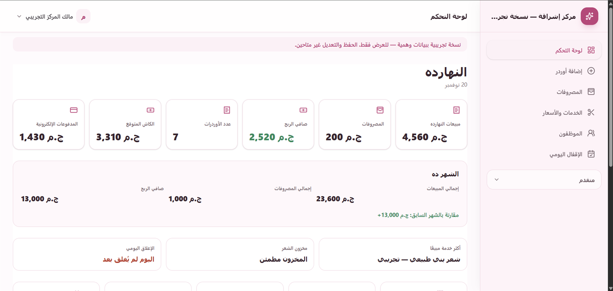
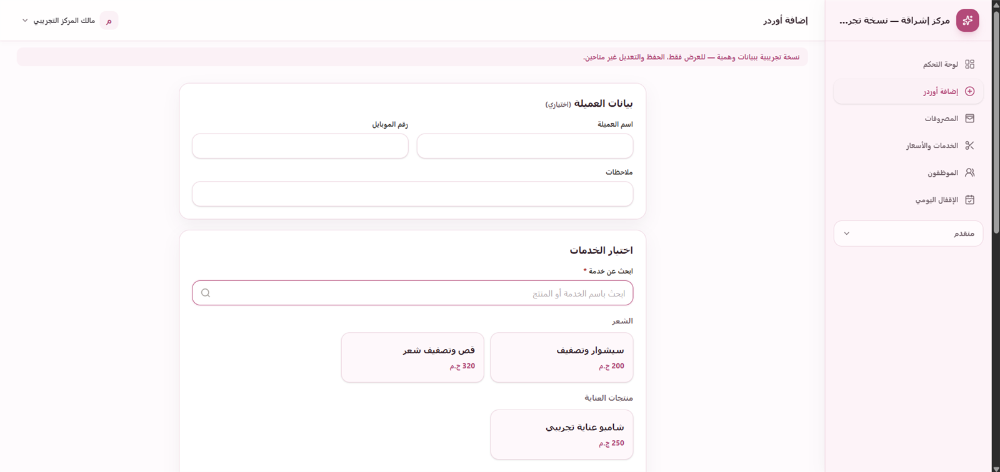
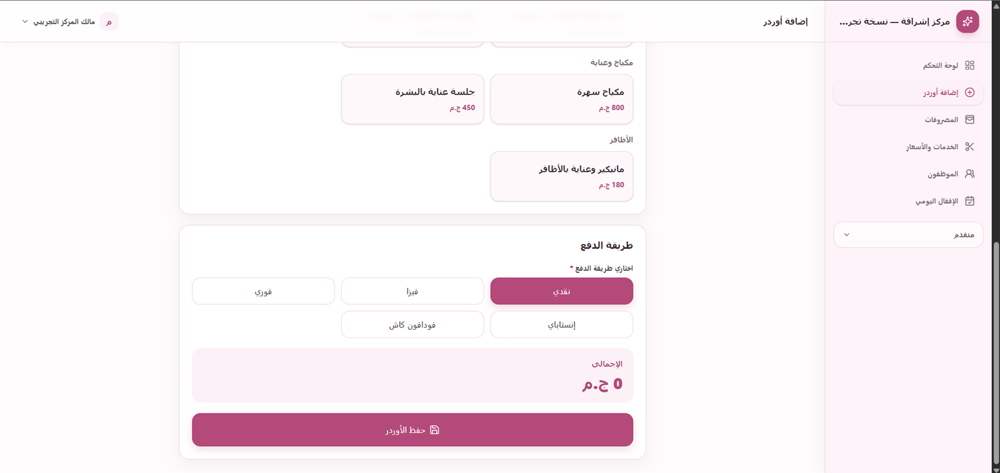
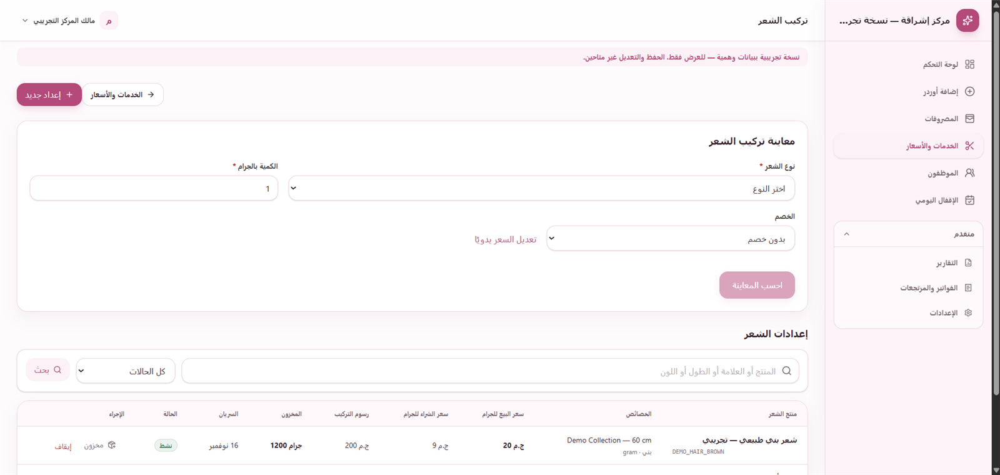
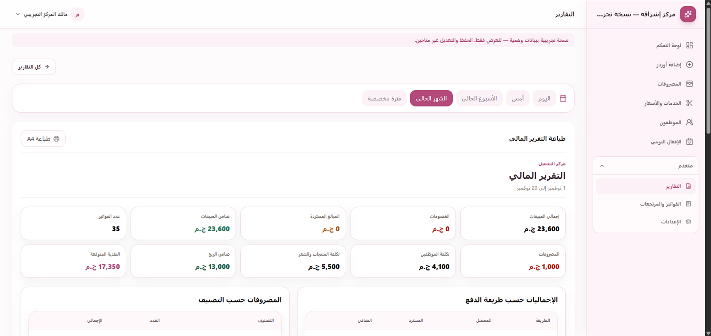
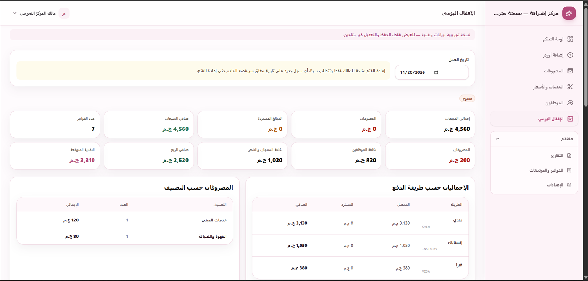
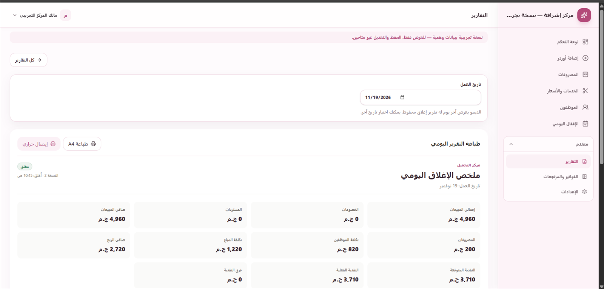
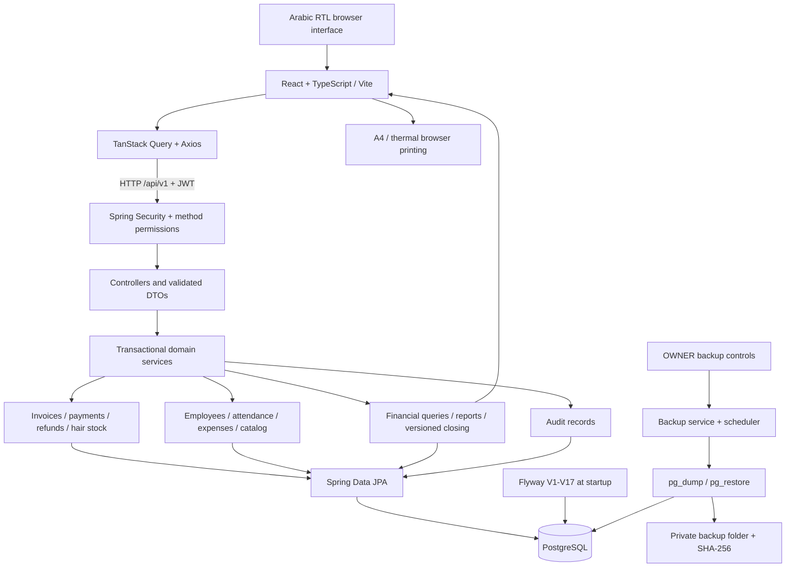

# Beauty Center Management System

An Arabic RTL workspace for the beauty-center owner balancing the till at closing time and the receptionist recording the next order. Daily operations run locally on Windows with PostgreSQL.

     



## Try the demo

[Open the live demo](https://volumes-unveiling-clutter.ngrok-free.dev/) · [Watch the walkthrough on YouTube](https://youtu.be/yUMPXhUyneM)

**Demo only, fictional data.** Both accounts are read-only. You can browse and preview calculations. The server blocks creating and saving business data.

| Username | Demo password | Access |
| --- | --- | --- |
| `owner` | `ownerdemo123` | Full owner view |
| `staff` | `staffdemo123` | Limited staff view |

The demo runs from my own machine and may be offline. The video covers the workflow when the live site is unavailable. On your first visit, ngrok may show a warning page. Click **Visit Site** to continue.

## What it does

- One-time OWNER setup, staff registration and OWNER approval, configurable staff permissions, BCrypt passwords, JWT authentication and login throttling.
- Configurable business name, logo, contact details, receipt information and display currency.
- Catalog-based multi-service quick orders, optional customer details and service performer, plus the existing advanced invoice workflow with split payments, discounts, cancellation and refund records.
- Catalog prices and purchase costs, price-change history, scheduled discounts and hair-installation configurations with minimum grams, stock movements and calculation previews.
- Employee attendance, daily wage accrual, advances, commissions, bonuses, deductions, payments and statements.
- Expenses, configurable categories and payment methods, cancellation and financial summaries.
- Dashboard, date-range reports, cash reconciliation, versioned daily closing and OWNER-authorized reopening.
- A4 and compact thermal print layouts; manual/scheduled PostgreSQL backups, history, retention, checksum verification and guarded OWNER restore/delete actions.

## Screenshots

The Arabic interface reads right to left. Follow an order from service selection through payment, then review the day's totals.

| | |
| --- | --- |
|  **Select services** for a quick order. |  **Preview payment** and the order total. |
|  **Manage catalog prices** and review changes. |  **Review a period** by revenue, expenses and profit. |
|  **Reconcile the day** against payment totals. |  **Read the saved closing** for a selected date. |

## Engineering highlights

- **Quick-order idempotency.** A request key prevents a retried checkout from completing the sale twice. Invoice creation, payment validation and completion share one transaction.
- **Historical snapshots.** Completed invoice lines retain their price, cost and discount values. Editing the catalog preserves the original sale margin.
- **Server-side pricing.** The backend loads catalog prices and calculates order totals. Hair previews use the service configuration and requested quantity.
- **Closed-day locks.** Closing a business date blocks further financial changes. The owner records a reason to reopen it, and closing it again creates another version with its own totals.
- **Permissions and redaction.** The backend enforces role and staff permissions, scopes staff invoice access and redacts restricted cost and profit values from responses.
- **Audit logging.** Authentication and sensitive operational changes leave an audit trail, including owner actions and price overrides.
- **Backup and restore.** The backend records a SHA-256 checksum for PostgreSQL archives. Restore requires owner confirmation, validates the archive and creates a safety backup before calling `pg_restore`.

## Architecture



[Architecture and financial safeguards](docs/ARCHITECTURE.md)

## Tech stack

| Layer | Implementation |
| --- | --- |
| Frontend | React 19, TypeScript, Vite 8, React Router, TanStack Query, Axios |
| UI/forms | Tailwind CSS 4, reusable Radix-based controls, React Hook Form, Zod |
| Backend | Java 17, Spring Boot 3.5, Maven, Spring Security, Spring Data JPA |
| Storage | PostgreSQL 17; Flyway migrations V1–V17 |
| Verification tooling | JUnit/Spring Boot tests; Vitest and Testing Library |

## Testing

From `backend`, run `mvn clean verify` with Java 17. From `frontend`, run these commands with Node.js 20.19 or later.

```powershell
npm.cmd ci
npm.cmd run typecheck
npm.cmd test
npm.cmd run build
```

Verified on Windows with Java 17 and Node.js 24.14.0. Maven built the backend and passed all **109 tests** (0 failures, errors or skips). Vitest passed all **68 tests across 25 files**. TypeScript typechecking and the Vite production build both passed.

## Getting started

1. Copy `.env.example` to a private `.env`. Set the database connection and generate an independent JWT secret of at least 32 characters. For Docker, match the `POSTGRES_*` values to the backend database settings.
2. Install frontend dependencies with `npm.cmd ci` from `frontend`. With Docker Desktop running, launch `Start-BeautyCenter.bat` from the project root. The default ports are 5173 for the frontend, 8080 for the API and 5432 for PostgreSQL.
3. For native PostgreSQL 17, create a dedicated database and login, export the environment variables, then start Maven and Vite in separate terminals using the Windows guide.
4. On an empty database, open the frontend and create the initial OWNER account with your own password. Each installation has its own credentials.

[Windows installation and startup](docs/INSTALLATION_WINDOWS.md) · [دليل الاستخدام بالعربية](docs/USER_GUIDE_AR.md)

## Project context

I designed and reviewed this application for a commercial beauty-center client, with AI-assisted development using Codex. The portfolio demo uses fictional business records.

## Limitations

Customer name and phone are optional fields on an order. Dedicated customer management and appointment scheduling are outside the application's scope. Windows setup uses development launchers. A commercial installer and an automated end-to-end PostgreSQL restore drill are outside this release.

## Contact

Omar Ahmed Mohamed Nabil · [GitHub](https://github.com/OmarAhmed770) · [LinkedIn](https://www.linkedin.com/in/omarahmed71)
