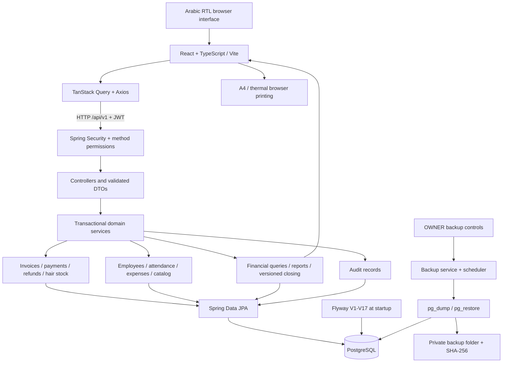

# Architecture

## Local-first modular application

The application is a React SPA and a Spring Boot modular monolith backed by PostgreSQL. Modules share one database and transaction manager; there is no second financial engine for quick orders or Demo mode.

The backend normally binds to loopback on port 8080; Vite development runs on 5173. Database connection settings are independent of whether PostgreSQL is native or containerized. pgAdmin is an optional administration client, not a database engine.

## Main responsibilities

| Area | Responsibility |
| --- | --- |
| `auth`, `setup`, `user`, `role` | JWT/BCrypt, throttling, first OWNER, registration approval and explicit permissions |
| `business`, `catalog`, `discount` | Business identity/currency, prices/history, scheduled discounts, hair configuration/stock |
| `sales`, `payment` | Draft and completed invoices, immutable line values, split tenders, cancellation/refund records |
| `employee`, `expense` | Attendance accrual, employee ledger, expenses and categories |
| `closing`, `report` | Closed-date protection, cash adjustments, shared financial queries and stored closing versions |
| `audit`, `backup`, `common` | Audit trail, local backup/restore, validation, DTO errors and shared infrastructure |

Frontend feature folders consume these APIs through a shared Axios client. TanStack Query manages loading/caching/invalidation; React Hook Form and Zod assist form validation. Server validation remains authoritative. Routes are defined in `frontend/src/App.tsx`.

## Authentication and authorization

- Stateless JWT authentication; BCrypt password hashes are not returned to the client. Login throttling and staff-registration rate limiting are server-side.
- First-run setup creates one OWNER and is closed once setup completes or users already exist. New staff registrations remain pending until OWNER approval.
- OWNER has all operational permissions. RECEPTIONIST represents staff with explicit permissions such as `ADD_ORDERS`, `EMPLOYEES`, `REPORTS` or `DAILY_CLOSING`.
- ADMIN remains only for legacy compatibility. V16 preserves its operational access as permissions, then converts its role assignment to RECEPTIONIST. Current database role constraints permit OWNER and RECEPTIONIST; a unique index enforces one OWNER.
- Account/permission administration, attendance, business-profile updates, reopening and backup/restore are separately OWNER-restricted. A menu item or permission name alone does not override these checks.
- Invoice access and cost redaction are checked server-side. The staff order view is creator-scoped unless the user has the broader invoice-management access.

## Financial and historical integrity

1. Quick orders load catalog prices on the server. The quick-order endpoint reuses invoice creation, item snapshots, payment validation and completion in one transaction; its request key prevents duplicate completion. The older manual simple-order and advanced draft APIs remain available.
2. Completed invoice lines retain price, cost, discount, hair-fee and performer snapshots. Catalog price changes create price history, not rewrites of earlier sales. The authenticated creator and the employee who performed a service are separate references.
3. Money uses `BigDecimal`. Completed payments must match the invoice total; active payment-method and reference requirements are validated on the server. Hair stock moves through the existing sale/cancellation workflows.
4. Attendance accrues a daily wage entitlement, not a cash payment. Advances/payments settle balances; paying an existing entitlement does not charge its cost to profit again. Employee transactions and expenses are cancelled with audit history rather than physically removed.
5. Shared server calculations supply reports and closing. Profit distinguishes revenue, item cost, expenses and accrued employee cost; physical cash uses actual cash movements, not card/wallet totals.
6. Business-date locks prevent financial changes to closed dates. OWNER reopening requires a reason. Reclosing creates another version; earlier financial totals stay intact even when lifecycle/reopening metadata changes. Default stored reports use the latest version, not recalculated catalog values.

## Database and backups

Flyway owns schema evolution; JPA uses `ddl-auto: validate`. V1–V7 establish core operations, V8–V12 add account/setup/profile/registration/linking/quick-order support, V13 adds hair stock, V14 versions closings, V15 adds attendance, V16 adds staff permissions, and V17 adds backup settings/history. Applied migrations must not be rewritten.

OWNER can configure backup folder, daily schedule and retention. The running backend invokes `pg_dump` for custom-format archives and records size/checksum/history. Restore validates the chosen archive and OWNER confirmation, creates a safety backup, and uses `pg_restore`. Scheduling requires the application and database to be running; archive availability is not proof that a restore drill has passed.

## Demo boundary

The `demo` Spring profile uses its own database, role and JWT configuration, binds to 127.0.0.1:8082, disables backup execution and Swagger, and validates its database target before Flyway connects. The frontend uses 127.0.0.1:5175 and displays a read-only notice.

`DemoReadOnlyFilter` rejects business writes even for OWNER. Exceptions are login and the pure hair preview containing only configuration, quantity and optional discount inputs; price overrides are blocked because they write audit records. Read-only is a business-data guarantee, not suppression of login audit/lockout bookkeeping.

The demo profile checks the database name, role and target host before connecting. Database access rules must also be configured on the PostgreSQL server.
